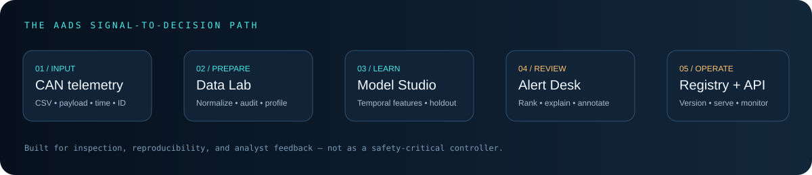

# AADS-4.2-AUTOMOTIVE-AI-SECURITY-PLATFORM

<div align="center">


### A vehicle-telemetry ML workbench built to inspect signals, compare temporal models, and trace alerts.

<p>
  <a href="https://github.com/SAI-SRINIVAS-P/AADS-4.2-AUTOMOTIVE-AI-SECURITY-PLATFORM"></a>
  <a href="LICENSE"></a>
  
  
  
</p>

<p><a href="#quick-start">Quick start</a> · <a href="#platform-tour">Platform tour</a> · <a href="#run-the-tests">Tests</a> · <a href="#api-quick-reference">API</a> · <a href="#limitations-and-responsible-use">Limitations</a></p>

</div>

---

## Signal in. Context out.

AADS 4.2 is a local research platform for exploring automotive CAN-style telemetry, engineering temporal features, comparing supervised classifiers, scoring unusual records, and reviewing model behavior. It combines a Streamlit operator workspace with a FastAPI inference service and a lightweight model/feedback registry.



> **Research prototype, not a vehicle safety controller.** An anomaly flag means that a model found a record unusual under its learned patterns. It does not prove an attack or justify controlling a vehicle.

## Platform tour

The project includes seven operator workspaces:

| Workspace | What it is for |
|---|---|
| **Mission Control** | Dataset summary, project status, and lifecycle entry point. |
| **Data Lab** | Schema normalization, data-quality checks, signal exploration, and normalized exports. |
| **Model Studio** | Payload-only baseline vs temporal feature models, chronological train/validation/test windows, and evaluation metrics. |
| **Alert Desk** | Anomaly scoring, record review, export, and analyst feedback. |
| **Model Registry** | Candidate metadata, saved artifacts, and selection of a model for local inference. |
| **Monitoring** | Alert history, feedback summaries, and exploratory drift indicators. |
| **API & Ops** | Local service status, endpoint guidance, and operational checks. |

The custom animated title and workflow graphic above are SVG assets and render crisply at different screen widths. GitHub does not run the Streamlit interface inside the README; launch the app locally to interact with each workspace.

## What is inside

- **CAN-style data ingestion** for canonical fields and common timestamp, CAN-ID, payload, and per-byte representations.
- **Data quality and EDA** for missing values, label distributions, signal profiles, and schema warnings.
- **Shared feature pipeline** for raw signal summaries and temporal context such as message gaps, recent message frequency, and signal-change behavior.
- **Model experiments** comparing temporal models against a payload-only baseline using ordered data windows.
- **Threshold selection and evaluation** using validation data separately from the final chronological test slice.
- **Anomaly scoring** with Isolation Forest for unsupervised exploration.
- **Alert review and feedback** stored locally for analyst workflows.
- **FastAPI inference endpoints** for a record or batch, plus health, alert, and metrics routes.
- **Reproducible developer workflow** with pytest, GitHub Actions, Windows helpers, and Docker Compose.

## Architecture

```text
compressed_data.csv.gz / uploaded CSV
                │
                ▼
       Schema + quality checks
                │
                ▼
       Shared feature pipeline
       ├── payload summaries
       └── prior-message temporal features
                │
                ▼
       Model Studio experiment
       ├── chronological training window
       ├── time-ordered validation window
       └── later final-test window
                │
                ├───────────────┐
                ▼               ▼
          Model Registry   Alert Desk / Isolation Forest
                │               │
                ▼               ▼
           FastAPI API     SQLite alert + feedback history
                │               │
                └──────┬────────┘
                       ▼
                  Monitoring
```

## Prerequisites

| Requirement | Why | Link |
|---|---|---|
| **Python 3.11 or newer** | Runs the dashboard, ML pipeline, tests, and API. | [Download Python](https://www.python.org/downloads/) |
| **Git** | Clone and version the project. | [Install Git](https://git-scm.com/downloads) |
| **Visual Studio Code** *(recommended)* | Convenient editor and integrated terminal. | [Download VS Code](https://code.visualstudio.com/) |
| **Docker Desktop** *(optional)* | Run dashboard and API in containers. | [Install Docker Desktop](https://www.docker.com/products/docker-desktop/) |
| **RAM and disk space** | The bundled compressed dataset expands to over one million rows; training uses bounded row samples by default. | Close heavy apps if memory is limited. |

Internet access is required the first time Python dependencies are installed. After installation, the default bundled-data workflow can run locally.

## Quick start

### Windows · PowerShell

```powershell
git clone https://github.com/SAI-SRINIVAS-P/AADS-4.2-AUTOMOTIVE-AI-SECURITY-PLATFORM.git
cd AADS-4.2-AUTOMOTIVE-AI-SECURITY-PLATFORM

py -3.11 -m venv .venv
.\.venv\Scripts\Activate.ps1
python -m pip install --upgrade pip
python -m pip install -r requirements.txt

python -m pytest -q
python -m streamlit run app.py
```

Open **http://localhost:8501**. If PowerShell blocks environment activation, use this process-only policy, then activate again:

```powershell
Set-ExecutionPolicy -Scope Process -ExecutionPolicy RemoteSigned
.\.venv\Scripts\Activate.ps1
```

You can also run `setup_windows.bat` to install dependencies and run tests, then use `run_dashboard.bat` to launch the UI. These helper scripts are shortcuts; the commands above show the underlying steps.

### macOS / Linux

```bash
git clone https://github.com/SAI-SRINIVAS-P/AADS-4.2-AUTOMOTIVE-AI-SECURITY-PLATFORM.git
cd AADS-4.2-AUTOMOTIVE-AI-SECURITY-PLATFORM
python3.11 -m venv .venv
source .venv/bin/activate
python -m pip install --upgrade pip
python -m pip install -r requirements.txt
python -m pytest -q
python -m streamlit run app.py
```

### Docker Compose (optional)

With [Docker Desktop](https://www.docker.com/products/docker-desktop/) installed and running:

```bash
docker compose up --build dashboard api
```

- Dashboard: http://localhost:8501
- API docs: http://localhost:8000/docs
- Stop services with `Ctrl+C`, or run `docker compose down` in another terminal.

The optional training profile is invoked with:

```bash
docker compose --profile training run --rm trainer
```

## Run an experiment

1. Open **Model Studio**.
2. Keep the bundled dataset selected for the initial run.
3. Run the model experiment once and wait for completion.
4. Compare precision, recall, F1, PR-AUC, ROC-AUC, false-positive rate, and the confusion matrix. Do not choose a model from accuracy alone.
5. Inspect the train, validation, and final-test windows and any attack-prevalence warning.
6. Open **Model Registry** to review candidates before promoting one for local API inference.
7. Use **Alert Desk** for unsupervised scoring and review/export records as needed.
8. Open **Monitoring** to inspect recorded alerts, feedback, and drift indicators.

### CLI training

The CLI training script fits a model from the selected input and registers a candidate. It is a training command, not a substitute for the Model Studio chronological evaluation report.

```bash
python -m scripts.train --input compressed_data.csv.gz --max-rows 50000
```

Select a supported model name if desired:

```bash
python -m scripts.train --input compressed_data.csv.gz --max-rows 50000 --model "Extra Trees"
```

Use a bounded row count on a laptop first. Larger datasets increase memory and runtime needs.

## API quick reference

Start the service in a **second terminal** with the virtual environment active:

```bash
python -m uvicorn api:app --reload
```

Interactive documentation: **http://localhost:8000/docs**

| Method | Route | Purpose |
|---|---|---|
| `GET` | `/health` | API and active-model health information. |
| `POST` | `/predict` | Score one telemetry record. |
| `POST` | `/predict/batch` | Score a batch of records. |
| `GET` | `/alerts?limit=100` | Retrieve recent alert history. |
| `POST` | `/alerts/{prediction_id}/feedback` | Store analyst feedback for an alert. |
| `GET` | `/metrics` | Retrieve basic local prediction/service metrics. |

The API needs an appropriate registered/promoted model for supervised predictions. If no model is active, train and promote a candidate in the UI or run the training script first. Requests should use the schema documented at `/docs`; do not assume arbitrary external CAN CSV schemas are accepted by the single-record API without normalization.

Example health check:

```bash
curl http://localhost:8000/health
```

For interactive prediction, use **POST `/predict` → Try it out** in Swagger UI and follow the request schema shown by the running API. This avoids copying a request that does not match the model's current feature contract.

## Run the tests

From the repository root with the virtual environment active:

```bash
python -m pytest -q
python -m compileall -q app.py api.py src scripts
```

The repository also includes a GitHub Actions workflow under `.github/workflows/ci.yml` for automated checks. A passing unit-test suite confirms the tested code paths, not real-world automotive attack detection efficacy.

## Understanding the metrics responsibly

In the supplied platform recording, one bounded chronological experiment used **50,000 training rows, 25,000 validation rows, and 25,000 final-test rows**. That recorded run showed an F1 score near **0.995** for the temporal candidates and roughly **0.093** for the payload-only Extra Trees baseline.

Those values are a **single dataset/run illustration from the supplied recording**, not a general performance guarantee. Temporal patterns and message IDs can fingerprint the particular dataset or attack collection. Before making claims, evaluate on independent drives/vehicles, later collection periods, and attack scenarios not used during development. Check confusion matrices and false alarms as well as F1/PR-AUC. Repeatedly using the final test set for model selection turns it into another validation set.

## Repository map

```text
.
├── app.py                       # Streamlit workspace UI
├── api.py                       # FastAPI service
├── requirements.txt             # Python dependencies
├── compressed_data.csv.gz       # Bundled CAN-style dataset
├── src/
│   ├── data.py                  # Loading, schema normalization, labels
│   ├── quality.py               # Data quality checks
│   ├── features.py              # Shared payload + temporal feature pipeline
│   ├── models.py                # Experiment, evaluation, anomaly scoring
│   ├── explain.py               # Lightweight local/global explanations
│   ├── registry.py              # Candidate registry and promotion
│   └── monitoring.py             # Alert history, feedback, drift indicators
├── scripts/train.py             # CLI training workflow
├── tests/                       # Unit and API tests
├── .github/workflows/ci.yml     # CI checks
├── Dockerfile
├── docker-compose.yml
├── setup_windows.bat
├── run_dashboard.bat
├── start_api.bat
├── start_all.bat
└── train_model.bat
```

## Limitations and responsible use

- Research and portfolio project only; **not safety-certified and not suitable for direct connection to vehicle control systems**.
- Model scores depend on dataset provenance, labels, sampling, feature design, and split strategy.
- Drift indicators identify distribution changes; they do not prove performance degradation or an attack by themselves.
- Local feature sensitivity is an explanatory aid, not a causal diagnosis.
- Alert feedback is a record for review; it does not automatically retrain or improve the current model.
- Before exposing the API publicly, add authentication, rate limiting, secret management, audit logging, access controls, and deployment monitoring.
- Do not commit trained model files, local databases, credentials, or raw private telemetry. Review `.gitignore` before publishing artifacts.

## Development roadmap

- [ ] Validate across separate vehicles and drive sessions.
- [ ] Add a dedicated untouched external benchmark and repeatable benchmark report.
- [ ] Calibrate alert thresholds to an explicit operational false-alarm budget.
- [ ] Add authentication and rate limiting before any shared deployment.
- [ ] Evaluate temporal feature stability when CAN IDs, vehicle types, or collection conditions change.

## License

Released under the [MIT License](LICENSE). Dataset rights and attribution should be verified separately before redistributing external data.

<div align="center">

**Observe the signal. Test the assumption. Trust the evidence.**

<sub>AADS 4.2 · Automotive AI Security Platform · local research build</sub>

</div>
